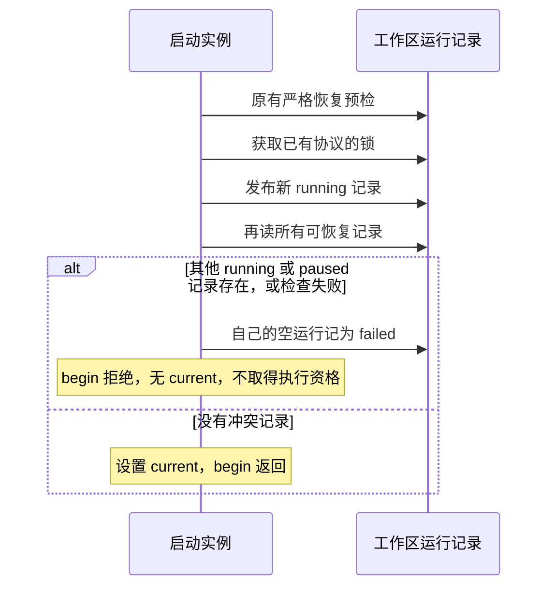

# 运行启动发布检查与后续锁协议 · 2026-11-06

状态：0.20.14 未发布候选。本轮修补启动资格检查，底层锁文件清理仍需后续协议设计。

## 复现的交错

在 `49c6e4644ff64b53d278899e195b19f06f1f2209` 的精确 CLI 归档（SHA-256 `e5012e66414f1c0d8747cf1fb961510d61944e30797c905747b1677b91c30aef`）上，Node 24/20 的私有真实目录实验均观察到两个独立 Journal 实例得到 running/current，且都能保存操作。

1. 终态记录已写入，旧锁因模拟崩溃尚未释放。
2. A 读到这个旧锁与终态，在 unlink 前暂挂。
3. B 通过正常 begin 清理旧锁，创建自己的锁并发布新运行记录。
4. A 继续 unlink，删除的实际是 B 的新锁；随后 A 也创建锁、写运行记录并返回。

实验仅以可控异步回调排列两实例的本地 IO，没有模型请求、远端副作用、用户目录写入或随机等待。它证明可达交错，不代表实际发生频率或跨机器测量。

## 当前修补

发布后再检查使并发启动者相互可见。即使对方在第一次预检后才发布、已经暂停、或已退出留下未知结果，也不得绕过明确恢复决定。检查失败留下终态、零操作的启动失败记录；错误仍返回，不自动重试。只修改本次新建记录，不回滚已经确认放弃的旧来源，不改竞争者的记录。

四个确定性回归见 [启动检查测试](../../test/task-run-start-fence.test.ts)：B 已发布后 A 继续清理；B 延迟发布而 A 先成为活动任务；发布后目录检查 EIO；B 在清理窗口内暂停且留下待核实副作用。既有新工作区原子抢锁、活所有者拒绝、PID 复用及未知副作用规则继续验收。

## 边界与下一步

本次利用运行记录约束本版本参与者的启动资格，依赖唯一 runId、应用记录的正常持久化/读取语义，以及各写者都执行新的发布检查。它没有把 lstat/read/unlink 变成内核原子操作，也不能约束旧版本程序或外部进程直接修改记录。一次清理仍可能删除后来出现的锁文件；活动记录的前置检查会继续阻止本版本新任务，后续需要处理锁状态诊断与完整协议。

下一轮应单独比较内核文件锁的跨平台依赖成本、带所有者收据的版本化锁协议及明确的旧客户端隔离；不可用增加一次 pathname 检查声称已经消除 TOCTOU。需覆盖进程退出、PID 复用、进程在发布/收尾间被终止、遗留旧锁、跨实例并发、权限/IO 错误、锁状态与活动记录不一致。若引入新格式，必须保留旧中断记录并提供可中断迁移，不直接删旧槽。

POSIX 工作区身份碰撞仍按 [身份迁移方案](./WORKSPACE_IDENTITY_MIGRATION_2026-11-06.zh-CN.md) 推进；启动发布检查不能验证记录归属，也不替代信任、审批、Plan、临时 Full Access 或未知副作用确认。
